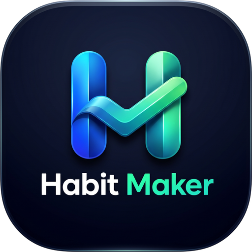

<div align="center">



# Habit Maker

**Build good habits, focus deeply and use your phone with intention.**

An open-source Android app for habit tracking, focus sessions, app and website blocking, screen-time stats and exam-prep routines. Everything stays on your phone: no ads, no tracking, no server.

[](LICENSE)


</div>

---

## Features

### ✅ Habits
- Daily habits with an icon, a colour, the weekdays they apply to and a times-per-day target
- Current and best streaks that count only scheduled days
- Exact-time reminders that are re-scheduled after a reboot or an app update
- A per-habit history calendar

### ⏱️ Focus timer
- Pomodoro-style focus and break sessions that keep running with the app closed (foreground service with a countdown notification)
- **Strict mode**: the session can't be paused or stopped early
- Session history and focus stats

### 🚫 Blocking
- Block distracting apps during focus, on demand ("block now") or on a schedule (schedules can cross midnight)
- Daily time limits per app
- Block only **YouTube Shorts / Instagram Reels** and keep the rest of the app usable
- Block websites in Chrome, Brave, Edge, Firefox, Opera, Samsung Internet and DuckDuckGo
- A full-screen block prompt with an optional "5 more minutes" snooze
- In strict mode, Habit Maker can't be switched off or uninstalled until the session ends

### 📚 Exam prep routine
- Builds a daily routine (wake, study, breaks, meals, sleep) for students, working people or part-timers
- Study blocks can start the focus timer, and app blocking with it, automatically
- Study blocks are marked done or missed, and a calendar shows each day's result
- A wake-up alarm over the lock screen with your own sound, volume ramp, vibration, flashlight blink and snooze

### 📊 Stats & widgets
- Screen time, unlocks and per-app usage
- Four home-screen widgets: **Today**, **Focus**, **Habits** (tick habits off from the home screen) and **Calendar**

### 🔒 Private by design
- Local account and guest mode. The password is stored only as a salted hash on the phone
- JSON backup and restore to a file you choose
- No internet permission. See [PRIVACY.md](PRIVACY.md)

---

## Tech stack

| Area | Library |
|---|---|
| Language | Kotlin 2.2 |
| UI | Jetpack Compose, Material 3 |
| Navigation | Navigation Compose |
| Storage | Room (habits, logs, rules, routine), DataStore Preferences (settings, auth) |
| Background | AlarmManager (exact alarms), foreground services, BroadcastReceivers |
| Blocking | AccessibilityService and an overlay prompt |
| Usage data | `UsageStatsManager` |
| Widgets | Jetpack Glance |
| Build | Gradle 9 (Kotlin DSL), AGP 9, KSP, version catalog |

**Min SDK** 24 (Android 7.0) · **Target SDK** 37

## Project structure

```
app/src/main/java/com/aravind/habitmaker/
├── App.kt, MainActivity.kt   App singletons (manual DI) and notification channels
├── navigation/               Routes and AppShell (bottom tabs + NavHost)
├── ui/                       Theme, shared components, root screen
├── core/
│   ├── auth/                 Local account (swap point for a real backend)
│   ├── blocking/             BlockPolicy: pure, unit-tested blocking rules
│   ├── focus/                FocusTimer state
│   ├── permissions/          Special-permission checks and settings intents
│   ├── prefs/                DataStore settings
│   ├── reminders/            Habit reminder alarms and the boot receiver
│   ├── routine/              Exam-prep routine model, alarms and focus flow
│   └── util/                 Dates, formatting, streaks
├── data/                     Room database, backup, installed apps, usage stats
├── feature/                  One package per screen group (home, habits, focus, blocking, prep, stats, profile…)
├── service/                  BlockerService, FocusTimerService, AlarmService
└── widget/                   Glance widgets
```

## Getting started

### Requirements
- Android Studio (a recent stable release that supports AGP 9)
- Android SDK Platform 37
- JDK: Gradle downloads the right toolchain (JDK 25) automatically

### Build and run

```bash
git clone https://github.com/Aravind-0808/habit-maker.git
cd habit-maker
./gradlew assembleDebug          # build the APK
./gradlew installDebug           # install it on a connected device
./gradlew testDebugUnitTest      # run the unit tests
./gradlew lintDebug              # run Android lint
```

Or open the folder in Android Studio and press **Run**.

### Permissions the app asks for

Most features need a special permission that the user turns on in Settings. The app's **Permissions** screen explains each one and links to it.

| Permission | Used for |
|---|---|
| Usage access | Screen time, unlocks, daily app limits |
| Accessibility service | Seeing which app or page is open, to show the block prompt |
| Notifications | Reminders, the focus timer, routine prompts |
| Alarms & reminders (exact alarms) | Reminders and the wake-up alarm at the exact minute |
| Full-screen intent | Showing the wake-up alarm over the lock screen |
| Unrestricted battery | Keeping blocking and timers alive in the background |

> **Note:** Google Play has a strict policy for apps that use the Accessibility API. You'll need a prominent in-app disclosure and a Play Console declaration if you publish this app there.

## Testing

Unit tests in `app/src/test` cover the logic that runs without a device:

- `BlockPolicyTest`: schedules across midnight, limits, site matching, Shorts rules
- `StreaksTest`: streaks on scheduled days only
- `RoutineTest`, `RoutineFlowTest`: routine generation and study → break → study hand-off
- `FormatAndReminderTest`: time formatting and next-reminder calculation

## Contributing

Contributions are welcome. Read [CONTRIBUTING.md](CONTRIBUTING.md) before opening a pull request.

## License

Habit Maker is released under the [MIT License](LICENSE).
